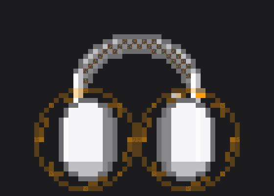
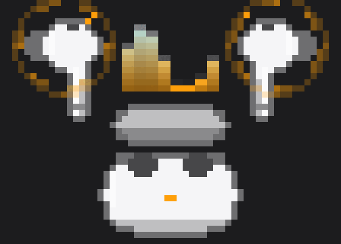
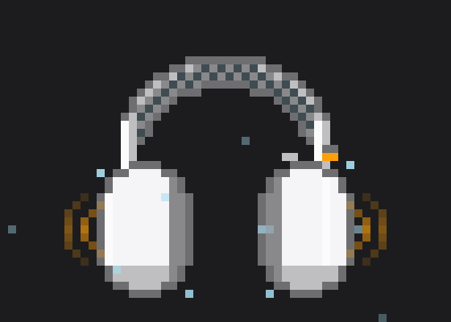
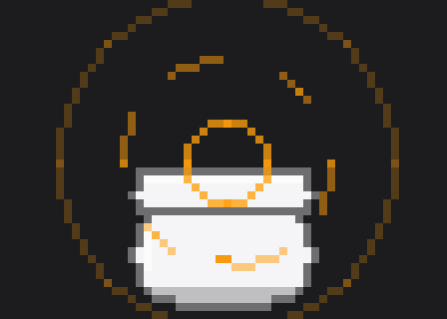
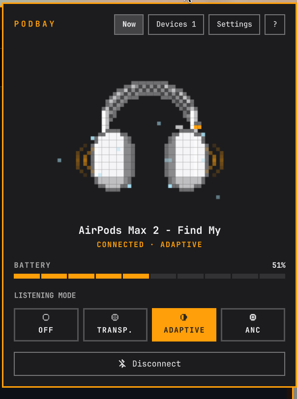
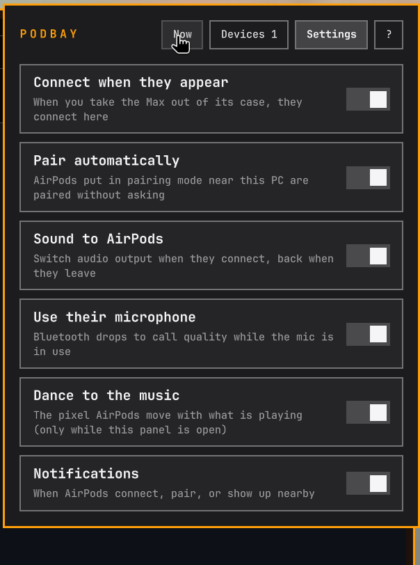

<div align="center">




# Podbay

**AirPods for the [Omarchy](https://omarchy.org) bar.**
Pixel-art AirPods in your theme colours, battery per bud and case, noise
control, and AirPods that just connect when you open the case.

*Open the pod bay doors.*

[](https://omarchy.org)
[](https://omarchyplugins.com)
[](https://quickshell.org)
[](bin/podbay-daemon)
[](https://www.bluez.org)
[](LICENSE)

</div>

---

## Highlights

| | |
|---|---|
| 🎧 **AirPods Max & AirPods Pro** | Animated pixel art for both, drawn in your Omarchy theme and redrawn when you switch themes. |
| 🔋 **Battery** | Left, right and case (or the Max's single battery), read straight from the AirPods. |
| 🔇 **Noise control** | Off, Transparency, Adaptive, ANC. Set it here, or press the button on the AirPods and Podbay follows. |
| ⚡ **Connects by itself** | Open the case or take the Max out: paired AirPods connect, and sound and mic move to them. Disconnect, and everything goes back. |
| 🤝 **Pairs by itself** | Put AirPods in pairing mode near the PC and Podbay pairs them. No Bluetooth menus. |
| 🗂️ **Several pairs** | Put them in order of preference; the higher pair wins and takes over. Or set a pair to connect only by hand. |
| 🎶 **Dances to the music** | Sound waves off the Max's cups, an equalizer between the Pro buds, while the panel is open. |

## Screenshots

<div align="center">

| Noise cancellation | Music | Pairing |
|:---:|:---:|:---:|
|  |  |  |

 


</div>

## Install

```bash
omarchy plugin add https://github.com/jvdp11/omarchy-podbay.git --enable
omarchy bar move jvdp.podbay --after omarchy.bluetooth   # optional: next to Bluetooth
```

Needs BlueZ, `python-dbus` and `python-gobject`, all on Omarchy by default.

## Use it

1. **Pair:** open the panel (click the icon), then
   - **AirPods Pro:** open the case and hold the button on the back,
   - **AirPods Max:** hold the noise control button,

   until the light flashes white. Podbay pairs and connects them.
2. **From then on:** open the case or take the Max out, and they connect.
   Sound and microphone follow; disconnect and they go back to what you had.

| In the bar | |
|---|---|
| Click | Open the panel |
| Right click | Next listening mode |
| Middle click | Connect / disconnect |

The icon turns your accent colour while noise cancelling and pulses when there
are AirPods around to pair. The panel has a **(?)** with all of this.

### Commands

```bash
omarchy-shell jvdp.podbay status        # JSON: text, devices, nearby
omarchy-shell jvdp.podbay mode anc      # anc | transparency | adaptive | off
omarchy-shell jvdp.podbay cycle         # next listening mode
omarchy-shell jvdp.podbay toggle        # connect / disconnect
omarchy-shell jvdp.podbay pair          # look for AirPods in pairing mode (90 s)
```

Bind one to a key in `~/.config/hypr/bindings.lua`, for example
`o.bind("SUPER + ALT + N", "AirPods mode", 'omarchy-shell jvdp.podbay cycle')`.

### Settings

In the panel's Settings tab, saved in `~/.config/omarchy/omarchy-podbay.json`:

| Key | Default | |
|---|---|---|
| `autoConnect` | `true` | Connect when they appear (case open, Max out) |
| `autoPair` | `true` | Pair AirPods put in pairing mode |
| `useOutput` / `useMic` | `true` | Move sound / microphone to the AirPods |
| `soundReactive` | `true` | Pixels dance to the music (panel open only) |
| `notify` | `true` | Notifications on connect, pair, nearby |
| `order`, `manualOnly` | | Order of preference, hand-only pairs (Devices tab) |

While the AirPods microphone is in use, Bluetooth drops to call quality. That
is Bluetooth headsets on any OS; turn off `useMic` to keep your own mic.

## How it works

```
 AirPods ──BLE adverts──▶ ┌──────────────────┐ ──JSON lines──▶ ┌─────────────┐
          (case open,      │  podbay-daemon   │                 │ Service.qml │──▶ bar + panel
           battery, lid)   │  Python · D-Bus  │ ◀──commands──── └─────────────┘
 AirPods ◀──AAP / L2CAP──▶ │  BlueZ agent     │
          (mode, battery,  └──────────────────┘
           ear detection)        │ pactl / omarchy-audio-*
                                 ▼
                          sound + mic routing
```

- **Here or not:** AirPods broadcast Apple *proximity pairing* messages over
  Bluetooth LE when the case opens or the Max wakes: model, battery (10 % steps),
  lid. Podbay scans for them briefly (6 s every 30 s) and only while no AirPods
  are connected, since scanning next to an audio stream can make it stutter.
- **Pairing:** in pairing mode those messages carry the pair's classic address;
  Podbay then searches classic Bluetooth and pairs over it (AirPods don't pair
  audio over LE), with a "just works" agent that only accepts AirPods it chose.
- **Noise control, battery, ears:** AAP, Apple's accessory protocol, on L2CAP
  PSM `0x1001`. Protocol details thanks to
  [LibrePods](https://github.com/kavishdevar/librepods).
- **Music:** `bin/podbay-levels` reads what is playing (`parec`), splits it into
  eight bands with Goertzel filters, about 20 times a second. It only runs while
  the panel is open.

### Models

| Model | Product id | Kind |
|---|---|---|
| AirPods Pro / Pro 2 / Pro 2 (USB-C) | `0x200E` `0x2014` `0x2024` | case + buds |
| AirPods Pro 3 | `0x2027` (unconfirmed) | case + buds |
| AirPods Max / Max (USB-C) | `0x200A` `0x201F` | over-ear |
| AirPods Max 2 | `0x202D` (confirmed) | over-ear |
| AirPods 1–4 | `0x2002` `0x200F` `0x2013` `0x2019` `0x201B` | case + buds |

Unknown `0x20xx` ids still work; the kind is guessed from the name or the
broadcast. Seen one that is wrong? Open an issue with the id from
`omarchy-shell jvdp.podbay status`.

## Development

```
bin/podbay-daemon    BlueZ, proximity adverts, AAP, pairing agent, audio routing
bin/podbay-levels    music levels for the animation
Service.qml          runs the daemon, holds state, prefs, notifications, IPC
BarWidget.qml        bar icon and the panel (Now · Devices · Settings · Help)
PodStage.qml         the animated pixel scene
Sprites.js           generated by tools/sprites.py (edit that)
```

- `tools/sprites.py --preview` regenerates `Sprites.js` and writes a preview PNG.
- `tools/StagePreview.qml` renders the scene's states off-screen.

## License

[MIT](LICENSE). Not affiliated with Apple. AirPods is a trademark of Apple Inc.
